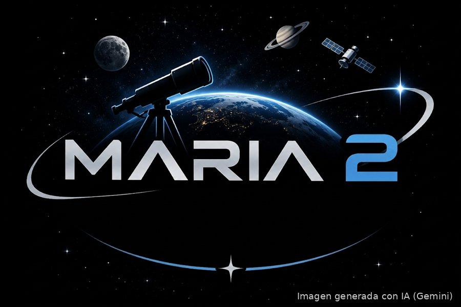

<p align="center"></p>

# María Site 2

**Rastreador interactivo de los equipos que la humanidad ha dejado en la Luna, en Marte y en el resto del sistema solar.**
Equipo **María 2** · Institución Educativa de María · NASA International Space Apps Challenge 2026 · Reto: *NASA's Discarded Equipment Storytelling*.

🔗 **Demo:** `https://TU-PROYECTO.vercel.app` · 📁 **Repositorio:** `https://github.com/AdrianVieiraDon/NOMBRE-DEL-REPO`

---

## 1. ¿Qué es?

Desde 1959 hemos dejado decenas de naves, rovers, módulos y restos de impacto en otros mundos. Sus datos existen, pero están repartidos en catálogos técnicos y casi siempre en inglés. **María Site 2** los reúne en una sola página: cada objeto aparece en su ubicación real, con su estado actual, fotos reales y una historia corta contada por dos personajes.

| Módulo | Qué hace |
|---|---|
| **Sistema solar 3D** | Escena navegable con 13 naves emblemáticas. Al tocar una, la cámara viaja hasta ella. |
| **Rastreador Luna & Marte** | Globos 3D con **95 registros en la Luna** (catálogo NSSDCA) y **28 en Marte** (18 en superficie y 10 orbitadores), ubicados por latitud y longitud. Incluye filtros por estado y buscador. |
| **Estados** | 🟢 Activo · 🔵 Pasivo (sin energía pero útil, como los retrorreflectores) · 🟠 Inactivo · 🔴 Impacto · 🟣 Perdido |
| **Fichas carrusel** | Fotos reales con crédito, fechas, agencia, coordenadas, historia y fuente. |
| **📺 Ver TV** | Cortometraje de 21 escenas (1959 → hoy) con tres canales, año animado, estática y narración por voz opcional. |
| **Narradores** | **Sury** (Surveyor 3, Luna) y **Oppy** (Opportunity, Marte) cuentan la historia en primera persona. |
| **Línea de tiempo** | De 1957 a hoy, en tres carriles (Luna, Marte y resto del sistema solar), coloreada por estado. |
| **Visor 3D** | Modelos 3D girables con zoom y fotos reales de cada nave. |
| **Videos y anexos** | Simulación educativa, video pitch y los PDF de investigación con lector integrado. |

## 2. Estructura del proyecto

```
maria-site-2/
├── index.html                 # Estructura de la página (solo HTML)
├── css/styles.css             # Todos los estilos
├── js/
│   ├── config.js              # ⚙️ LO ÚNICO QUE SE EDITA: repo, demo, videos, anexos, IA
│   ├── app.js                 # Lógica principal (módulo ES): 3D, rastreador, TV, línea de tiempo
│   ├── modelos3d.js           # Modelos 3D procedurales de cada tipo de nave
│   ├── proyecto.js            # Textos de los apartados del reto
│   ├── personajes.js          # Sury y Oppy (SVG)
│   └── data/
│       ├── luna.js            # 95 objetos lunares (NSSDCA)
│       ├── marte.js           # Superficie, orbitadores y misiones fallidas de Marte
│       ├── objetos-sistema-solar.js
│       ├── historia-tv.js     # Guion del cortometraje
│       └── imagenes-equipo.js
├── assets/img/                # Logos, portadas e imágenes del equipo
├── anexos/                    # PDF de investigación
└── docs/                      # GUION.md y PREGUNTAS.md para la exposición
```

## 3. Cómo ejecutarlo

Es un **sitio estático**: no tiene servidor ni base de datos.

- **En Vercel / GitHub Pages:** subir la carpeta tal cual. No necesita *build*.
- **En local:** como usa **módulos ES**, **no funciona con doble clic** (el navegador bloquea los módulos que vienen de `file://`). Usa un servidor:
  ```bash
  python -m http.server 8000      # luego abre http://localhost:8000
  # o la extensión "Live Server" de VS Code
  ```
- Necesita internet para cargar Three.js, las tipografías y las fotos de la NASA.

### Configuración (`js/config.js`)
```js
repo: 'https://github.com/...',          // enlace al repositorio
demo: '',                                 // vacío = usa la URL actual
videoSimulacion: 'https://youtu.be/...',  // YouTube no listado, Drive, Vimeo o 'videos/archivo.mp4'
videoPitch: '',                           // vacío = muestra "Próximamente"
anexos: [...], ia: [...]
```

## 4. Tecnologías

| Herramienta | Para qué | Cómo funciona |
|---|---|---|
| **HTML5** | Estructura | Secciones semánticas, `<canvas>` para WebGL e `<iframe>` para videos y PDF. |
| **CSS3** | Diseño | Grid, Flexbox, variables CSS, animaciones `@keyframes` (Ken Burns, parpadeo de los personajes) y `backdrop-filter`. Es *responsive* con `@media`. |
| **JavaScript (ES2022, módulos)** | Lógica | Sin frameworks. `app.js` importa `modelos3d.js` y Three.js mediante un **import map**. |
| **Three.js r160** | Gráficos 3D | Biblioteca sobre **WebGL** (la GPU del navegador). Usa `WebGLRenderer`, `PerspectiveCamera`, `MeshStandardMaterial` (PBR), `Sprite`, `Raycaster` y `TextureLoader`. |
| **OrbitControls** | Navegación 3D | Mueve la cámara en coordenadas esféricas alrededor de un punto, con amortiguamiento. Funciona con ratón y táctil. |
| **Canvas 2D** | Texturas y efectos | Brillo radial de los marcadores, estática de la TV y textura procedural de respaldo. |
| **SVG** | Ilustración | Personajes e íconos dibujados como vectores, con animación CSS. |
| **Web Speech API** | Voz de la TV | `speechSynthesis` lee el guion en español con la voz del navegador. |
| **IntersectionObserver** | Rendimiento | Pausa el render de cada escena 3D cuando no está en pantalla. |
| **jsDelivr (CDN)** | Librerías | Sirve Three.js y las texturas sin instalar nada. |
| **Google Fonts** | Tipografía | Unbounded, Inter, JetBrains Mono y Bangers (estilo historieta). |
| **Python** (Pillow, pdftoppm) | Preparación de datos | Convierte la tabla NSSDCA a JSON, optimiza imágenes y genera las portadas de los PDF. |
| **Git + GitHub** | Versiones | Repositorio del código. |
| **Vercel** | Publicación | *Hosting* estático con CDN global y despliegue automático en cada *push*. |

## 5. Matemáticas de la simulación

> La página es una **visualización basada en datos**: no integra ecuaciones de movimiento. Las posiciones salen de catálogos de la NASA y la escena del sistema solar es esquemática.

1. **Escala comprimida de distancias:** `r = 14·√d` (d en UA). A escala real, Mercurio y la Tierra no se verían al lado de Voyager 1 (~170 UA). La raíz cuadrada conserva el orden de las distancias pero acerca lo lejano.
2. **De latitud/longitud a 3D (coordenadas esféricas → cartesianas):**
   `φ = (lon+180)/360 · 2π`, `θ = (90−lat) · π/180`
   `x = −r·cos φ·sin θ`, `y = r·cos θ`, `z = r·sin φ·sin θ`
   Coincide con el mapeo **equirrectangular** de la textura, así que el marcador cae sobre el lugar correcto del mapa.
3. **Proyección en perspectiva:** cada punto 3D pasa por las matrices de vista y proyección hasta coordenadas normalizadas (NDC). Luego `x_px = (x+1)/2·W`, `y_px = (1−y)/2·H` sitúa las etiquetas HTML sobre el 3D.
4. **Raycasting (selección con clic):** se lanza un rayo desde la cámara a través del píxel tocado y se calcula su intersección con los marcadores y con la esfera. Si la esfera está más cerca, el marcador queda oculto detrás del planeta.
5. **Visibilidad por producto punto:** una etiqueta se muestra si `n̂ · ĉ > 0.25`, donde n̂ es la normal del punto y ĉ la dirección de la cámara (cara visible).
6. **Interpolación de cámara:** `p(t) = p₀ + (p₁ − p₀)·e(t)` con *easing* cúbico `e(t) = 4t³` si t < 0.5, y `1 − (−2t+2)³/2` si no.
7. **Orbitadores de Marte:** movimiento circular uniforme `θ(t) = θ₀ + ωt`, con planos inclinados mediante ángulos de Euler. *(Es simplificado: la ley real de Kepler da `ω ∝ r^(−3/2)`.)*
8. **Iluminación física (PBR):** difuso de Lambert más especular GGX/Cook-Torrance en `MeshStandardMaterial`. El Sol es una luz puntual.
9. **Textura procedural de respaldo:** ruido de **Perlin** con suavizado quíntico `6t⁵ − 15t⁴ + 10t³` y **fBm** de 5 octavas (cada octava con amplitud ×½ y frecuencia ×2).
10. **Línea de tiempo:** escala lineal `x = 120 + (año − 1957)·46 px`. Las misiones del mismo año se apilan verticalmente.

**Solvers:** no se usó un solver numérico (EDO ni Kepler). Mejora futura: resolver la ecuación de Kepler `M = E − e·sin E` con **Newton-Raphson**, o consumir efemérides reales de **JPL Horizons**.

## 6. Datos y fuentes

| Dato | Fuente |
|---|---|
| 95 objetos lunares (nombre, tipo, fecha, lat/lon) | [NSSDCA — *Anthropogenic Impacts and Spacecraft on the Moon*](https://nssdc.gsfc.nasa.gov/planetary/lunar/lunar_artifact_impacts.html) |
| Misiones a Marte, fechas y fotos | [NASA — 25 Years of Continuous Robotic Mars Exploration](https://www.nasa.gov/history/25-years-of-continuous-robotic-mars-exploration-from-pathfinder-to-perseverance) |
| Coordenadas de aterrizaje en Marte | PDS ODE (Washington University) · NSSDCA *Mars mileage guide* |
| Apolo 11, Surveyor 3, Lunokhod 1 | NSSDCA, NASA Science, LROC (Arizona State University) |
| Mars Pathfinder, Sojourner, Spirit y Opportunity | NASA Science y documentos de investigación del equipo |

**Proceso de datos:** extracción → limpieza (coordenadas decimales con norte y este positivos, fechas ISO, nombres en español) → clasificación por estado → enriquecimiento (historias, fotos con crédito) → JSON/JS → visualización.

**Imágenes:** se cargan directamente desde los servidores de la NASA (*hotlink*) con su crédito. Las imágenes de la NASA suelen ser de dominio público. Las de ESA, CNSA, ISRO o MBRSC tienen sus propias condiciones de uso.

## 7. Uso de inteligencia artificial

NASA Space Apps permite usar IA y exige indicar dónde y cómo se usó. Las imágenes generadas con IA deben llevar una marca visible.

| Herramienta | Uso |
|---|---|
| **Claude (Anthropic)** | Código HTML/CSS/JS, simulación 3D, extracción y orden de datos NASA, redacción de historias y guion, personajes SVG. |
| **Gemini (Google)** | Logo de María 2. La imagen lleva la marca "Imagen generada con IA". |
| **ChatGPT (OpenAI)** | *[Confirmar uso]* |

Todo el contenido generado con IA fue revisado por el equipo y contrastado con fuentes de la NASA.

## 8. Equipo María 2

Emanuel González Mazo (propietario) · Luciana Madrigal Cuartas · Koraima Restrepo · Josué Marín Hernández · Junior Alejandro Valencia Ramírez · Julio Vieira Donado — Colombia.
